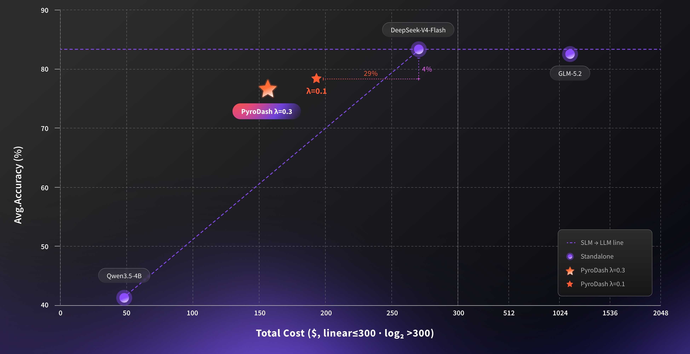
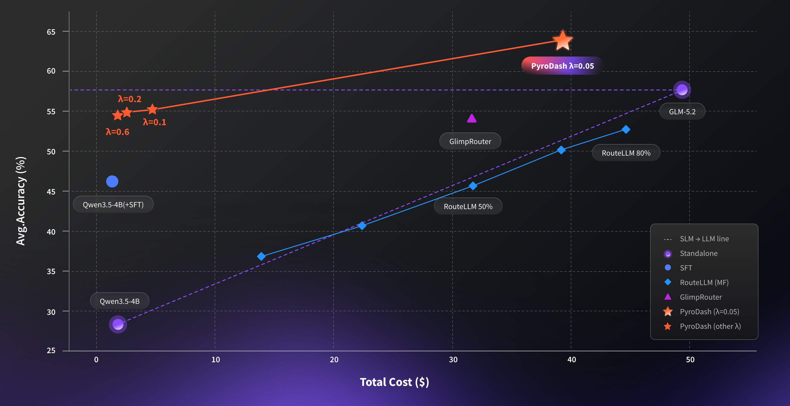
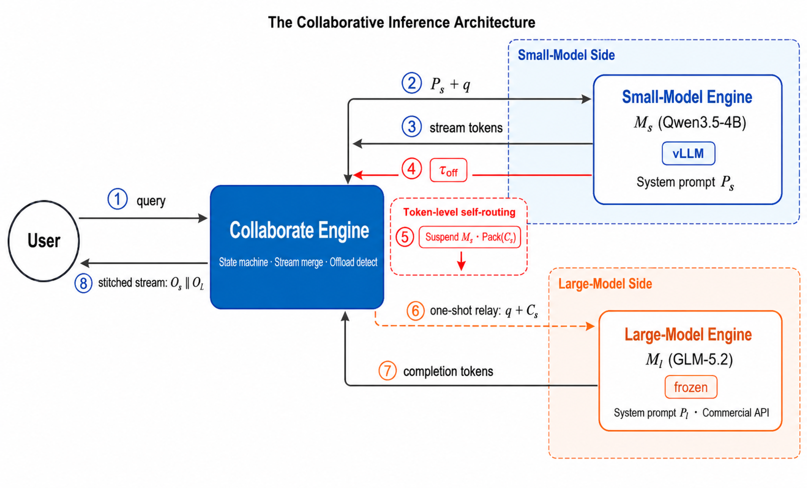
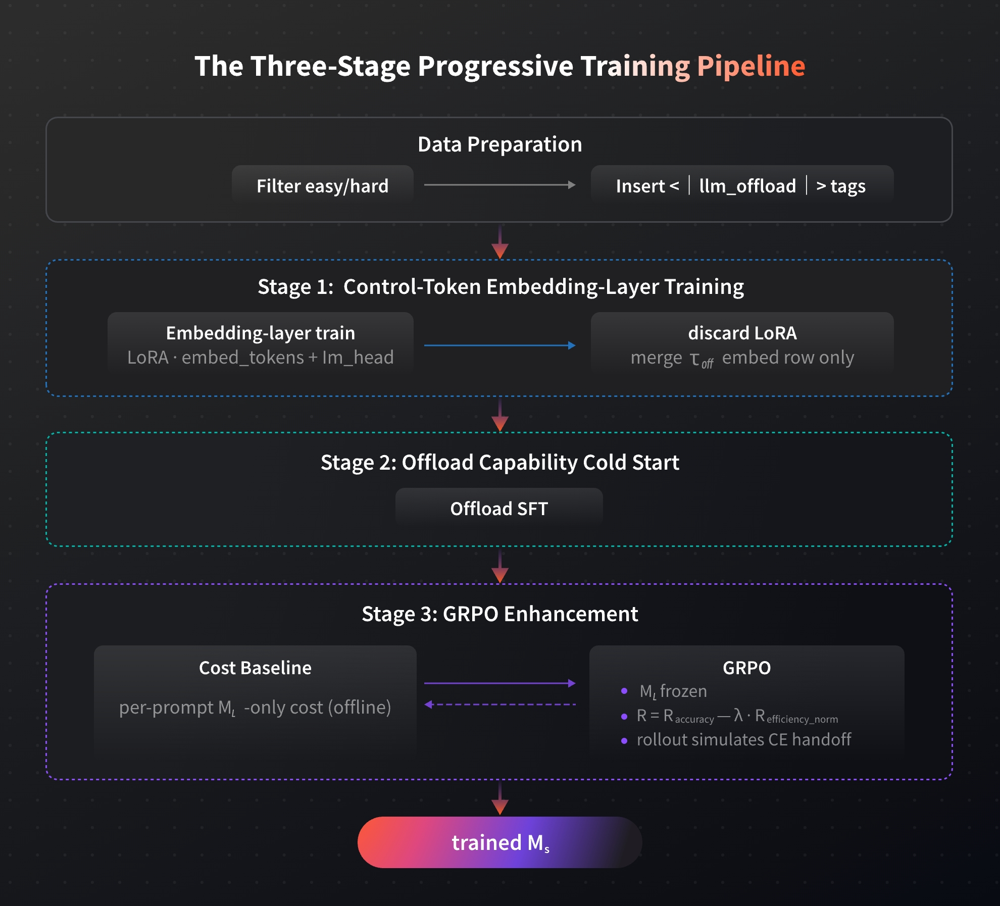

# pyroDash

**Language / 语言:** [English](README.md) | [中文](README_zh.md)

<a href="https://PyroMind-Dynamics.github.io/pyroDash/"></a>&nbsp;&nbsp;<a href="https://arxiv.org/abs/2607.20327"></a>&nbsp;&nbsp;<a href="https://huggingface.co/pyromind"></a>

---

## 🔥 Updates

- **2026-07-23**: Paper on [arXiv:2607.20327](https://arxiv.org/abs/2607.20327).
- **2026-07-22**: Release project page, math evaluation code, [EasyHard-24K](https://huggingface.co/datasets/pyromind/easyhard-24k), and models on [Hugging Face · pyromind](https://huggingface.co/pyromind) ([SFT](https://huggingface.co/pyromind/PyroDash-4B-SFT), [GRPO λ=0.05](https://huggingface.co/pyromind/PyroDash-4B-GRPO-Lambda-0.05), [GRPO λ=0.6](https://huggingface.co/pyromind/PyroDash-4B-GRPO-Lambda-0.6)). Milestone 1 math eval loop largely done; Collaborate Engine & one-click reproduce still in progress.

## 📊 Results


| Agentic-Preview                                                                              | Math                                                                       |
| -------------------------------------------------------------------------------------------- | -------------------------------------------------------------------------- |
|  |  |


> [!IMPORTANT]
> **Agentic-Preview changes**
>
> - Control token upgraded from `<|llm_offload|>` to `<|llm_offload|>N<|/llm_offload|>`, where N is an integer in 0–9 that selects the thinking level when handing off to a more capable model (finer-grained agentic coding collaboration).
> - Stage 2 training updated from offload SFT alone to **SFT + OPD**, improving the cold-start offload policy for agentic coding trajectories.
> - Agentic coding training datasets: **ScaleSWE**, **TMax**.
> - Evaluation: see [`evaluation/evaluation_code/swe-bench/README.md`](evaluation/evaluation_code/swe-bench/README.md)
> - More details will be released later.

---

<table>
<tr>
<td width="50%" valign="top">

</td>
<td width="50%" valign="middle" style="padding: 0 2em;">

&emsp;&emsp;We propose **PyroDash**, a token-level dynamic reasoning paradigm for collaborative inference between small and large language models. PyroDash enables the small model to autonomously emit the control token `<|llm_offload|>` during autoregressive streaming decoding; the collaboration engine then dynamically offloads the local reasoning chain to a large model based on this control signal. This approach requires neither an additional router model nor retraining of the large model, and is naturally compatible with closed-source LLM services.

</td>
</tr>
</table>

During training, PyroDash follows a three-stage progressive optimization pipeline: (1) train the control-token embedding layer so the small model acquires basic offloading expressiveness; (2) cold-start the offload capability to establish a collaboration pattern between the small and large models; and (3) apply GRPO reinforcement learning that jointly optimizes the dynamic offloading policy with a task-accuracy reward and a large-model call-cost penalty, achieving an adaptive balance between reasoning quality and compute cost. For more details, please refer to our paper (citation below).

<p align="center">
  
</p>

---

## 🚀 Quick Start

### 1. Setup

```bash
git clone https://github.com/PyroMind-Dynamics/pyroDash.git
cd pyroDash
pip install -r requirements.txt
```

### 2. Math offload + evaluation

Start the math adapter (local vLLM on `8001` + adapter on `18031`), then run the thin eval client:

```bash
# Terminal 1 — adapter (edit MODEL_PATH / LLM_*):
MODEL_PATH=/path/to/your/merged_model \
LLM_BASE_URL=http://your-llm-host/v1 LLM_API_KEY=... LLM_MODEL=... \
  bash offload/offload_math/api.sh

# Terminal 2 — benchmarks:
bash evaluation/evaluation_math/math_eval.sh
```

- Adapter: [`offload/offload_math/README.md`](offload/offload_math/README.md) — SLM `/completions` + bare `<|llm_offload|>` + LLM relay; `POST /v1/math/complete`
- Eval client: [`evaluation/evaluation_math/README.md`](evaluation/evaluation_math/README.md) — datasets, `\boxed{}` scoring, JSON

Tokenizer must include the special token `<|llm_offload|>`.

### 3. Code offload API (`offload/offload_code`)

Standalone SLM+LLM adapter (tag or entropy). Start the API, then point any client (SWE-bench, web UI, …) at `api_base`:

```bash
# edit MODEL_PATH / LLM_* / ports in the config block, then:
bash offload/offload_code/tag/api.sh
# or: bash offload/offload_code/entropy/api.sh
```

See [`offload/offload_code/README.md`](offload/offload_code/README.md). SWE-bench client: [`evaluation/evaluation_code/swe-bench/README.md`](evaluation/evaluation_code/swe-bench/README.md).

---

## 📊 Results

<p align="center">
  
</p>

---

## 📋 TODO

**Milestone 1 — Math eval loop**

- [x] Baselines: GLM-5.2 upper bound / Qwen3.5-4B lower bound + token cost stats
- [x] vLLM + GLM relay (`<|llm_offload|>`) + per-dataset JSON + cost aggregation
- [x] Comparisons: PyroDash / Query Router / Token Router + Pareto curve
- [x] λ sweep & ablations
- [ ] One-click reproduce on [PyroMind Console](https://pyromind.ai/) (end-to-end eval)
- [ ] Collaborate Engine

**Milestone 2 — Coding + Agentic**

- [ ] SWE-Bench (Verified / Lite) harness
- [ ] Terminal-Bench v2 harness
- [ ] Sandbox / scoring + offload trajectory & token stats
- [ ] Qwen3.5-4B / GLM-5.2 / PyroDash comparison + cost tables
- [ ] Unified Math + SWE + Terminal results & end-to-end scripts

**Milestone 3 — Coding Plan release**

- [ ] Product definition & collaborative inference integration
- [ ] Coding-scenario optimizations (completion / refactor / debug)
- [ ] Release & promotion

---

## 🔗 Resources

| Resource | Link |
|----------|------|
| Project website | [PyroMind-Dynamics.github.io/pyroDash](https://PyroMind-Dynamics.github.io/pyroDash/) |
| Paper | [arXiv:2607.20327](https://arxiv.org/abs/2607.20327) |
| Dataset (EasyHard-24K) | [huggingface.co/datasets/pyromind/easyhard-24k](https://huggingface.co/datasets/pyromind/easyhard-24k) |
| Hugging Face org | [huggingface.co/pyromind](https://huggingface.co/pyromind) |

---

## 📖 Citation

If you find PyroDash useful, please cite:

```bibtex
@misc{lyu2026pyrodash,
  title        = {PyroDash: Cost-Efficient Token-Level Small-Large Language Model Collaborative Inference},
  author       = {Niqi Lyu and Pengtao Shi and Wei Qiu and Jianlin Zhong and Sicong Xia and Jianyao Ma and Yicheng Ding},
  year         = {2026},
  eprint       = {2607.20327},
  archivePrefix= {arXiv},
  primaryClass = {cs.CL},
  url          = {https://arxiv.org/abs/2607.20327}
}
```

Dataset:

```bibtex
@misc{pyromind2026easyhard24k,
  title        = {{EasyHard-24K} v0.02},
  author       = {{PyroMind Dynamics}},
  year         = {2026},
  howpublished = {\url{https://huggingface.co/datasets/pyromind/easyhard-24k}}
}
```
